# 🗺️ Roadmap: Pokémon Emerald 3DS (Dual-Screen PT-BR 100%)

Este documento consolida o planejamento estratégico, o escopo técnico e o checklist de tarefas para entregar a versão definitiva de **Pokémon Emerald 3DS Dual-Screen** totalmente traduzida em Português do Brasil (PT-BR), com integração completa para a tela sensível ao toque, widescreen 400x240 sem deformações e estabilidade total no hardware original do Nintendo 3DS.

---

## 🎯 Objetivo Final
Entregar uma ROM/binário (`.3dsx` e `.cia`) de Pokémon Emerald com:
1. **100% dos textos e gráficos traduzidos para PT-BR** (Campanha, Batalhas, Battle Frontier, Pokédex e Menus).
2. **Interface Touch da Tela Inferior otimizada e responsiva**, com comandos claros e botões intuitivos.
3. **Layout de Batalha e Overworld em Widescreen 400x240 perfeito**, sem sobreposição de caixas de vida ou textos.
4. **Estabilidade de Hardware Absoluta**, com zero crashes ao suspender ou sair para o menu HOME.
5. **Telemetria e Diagnósticos Contínuos**, garantindo rastreabilidade através de logs estruturados (`port.log`).

---

## 🧭 Pilares do Desenvolvimento

```mermaid
graph TD
    A[Pokémon Emerald 3DS PT-BR 100%] --> B[1. Textos e Diálogos]
    A --> C[2. Gráficos e Menus Touch]
    A --> D[3. Layout e Widescreen]
    A --> E[4. Estabilidade e Engine 3DS]
    A --> F[5. QA e Telemetria Contínua]

    B --> B1[Campanha e Ginásios]
    B --> B2[Equipes Magma / Aqua]
    B --> B3[Battle Frontier e NPCs]
    B --> B4[Golpes, Itens e Habilidades]

    C --> C1[Pokédex e Pokénav PT-BR]
    C --> C2[Categorias de Contest]
    C --> C3[Bolsa e Caixa do PC]
    C --> C4[Barra de Diálogo na Captura do Wally]

    D --> D1[Healthboxes no Céu da Batalha]
    D --> D2[Batalhas em Dupla]
    D --> D3[Animação de Transição de Treinadores]

    E --> E1[Correção de Crash no HOME Menu]
    E --> E2[Velocidade Inteligente de Fast-Forward]
    E --> E3[Mecânica Segura de Salvamento]

    F --> F1[Telemetria em port.log]
    F --> F2[Testes Rápidos via Citra QA]
    F --> F3[Validação em Hardware Real 3DS]
```

---

## 📋 Checklist Detalhado de Implementação

### 1. Textos, Diálogos e História (PT-BR)
- [x] **Tradução Base Incorporada**: Sincronização com o repositório parceiro do Carlos Mozart contendo as correções ortográficas e termos principais.
- [x] **Pokédex (386 Entradas)**: Textos e descrições dos 386 Pokémon traduzidos (*Nota: no jogo original, descrições aparecem apenas para Pokémon capturados, exibindo `?????` para Pokémon apenas vistos*).
- [ ] **Campanha Principal (Cidades e Rotas)**:
  - [x] Littleroot, Oldale, Petalburg e Rustboro.
  - [ ] Dewford, Slateport e Mauville.
  - [ ] Fallarbor, Lavaridge e Fortree.
  - [ ] Lilycove, Mossdeep, Sootopolis e Pacifidlog.
  - [ ] Ever Grande City e Liga Pokémon.
- [ ] **Líderes de Ginásio e Elite Four**:
  - [x] Roxanne, Brawly e Wattson.
  - [ ] Flannery, Norman e Winona.
  - [ ] Tate & Liza e Juan.
  - [ ] Sidney, Phoebe, Glacia, Drake e Campeão Steven.
- [ ] **Eventos e Vilões**:
  - [ ] Encontros e diálogos da Equipe Magma e Equipe Aqua.
  - [ ] Crise climática em Sootopolis e despertar de Rayquaza.
  - [ ] Despertar dos Regis e lendas de Hoenn.
- [ ] **Batalha da Fronteira (Battle Frontier)**:
  - [ ] Diálogos dos 7 cérebros da fronteira (Battle Tower, Factory, Arena, Dome, Pike, Palace, Pyramid).
  - [ ] Regras e explicações dos guias de cada instalação.
- [ ] **Termos de Combate e Status**:
  - [x] Nomes dos golpes e tipos elementais.
  - [ ] Mensagens de status (Envenenado, Paralisado, Queimado, Congelado, Dormindo).

---

### 2. Gráficos, Sprites e Menus da Tela Inferior
- [x] **Gráficos da Pokédex**:
  - [x] Sprites de botões: *VISTOS*, *CAPTURADOS*, *BUSCAR*, *NACIONAL*, *HOENN*.
  - [x] Menus de ordenação e filtros por tipo e tamanho em português.
- [x] **Gráficos do PokéNav**:
  - [x] Sprites de seções: *MAPA*, *TREINADORES*, *CONDIÇÃO*, *FITAS*.
- [x] **Categorias de Concursos Pokémon (Contest)**:
  - [x] *Carisma*, *Beleza*, *Graça*, *Esperteza*, *Rigidez*.
- [ ] **Correção Visual de Diálogos Especiais**:
  - [ ] Ajustar a caixa de diálogo na introdução da captura do Ralts pelo Wally para não sobrepor o sprite de batalha.
  - [ ] Polir as vinhetas de transição ao colidir com o olhar de um treinador (intro battle swirl).
- [ ] **Menu Touch**:
  - [x] Coluna lateral com ícones responsivos (Mapa, Equipe, Bolsa, Treinador, Pokédex, PokéNav, Salvar, Opções).
  - [x] Atalhos rápidos para Corrida Contínua (Run) e Botão Y.

---

### 3. Layout e Adaptação Widescreen (400x240)
- [x] **Alinhamento das Healthboxes de Batalha (Individual)**:
  - [x] Healthbox do Oponente movida para o céu (`x = 4, y = 10`), desobstruindo totalmente o sprite do Pokémon adversário.
  - [x] Healthbox do Jogador posicionada no canto inferior direito (`x = 186, y = 74`).
- [x] **Alinhamento das Healthboxes em Batalha de Duplas**:
  - [x] Oponente 1: `x = 4, y = 8`
  - [x] Oponente 2: `x = 2, y = 30`
- [ ] **Revisão de Cenários de Batalha (Battle Backgrounds)**:
  - [x] Expansão para widescreen nativo sem esticar a proporção.
  - [ ] Validação visual em todos os terrenos (Grama, Areia, Caverna, Água, Prédio, Ginásios).

---

### 4. Estabilidade, Engine 3DS e Ciclo de Vida
- [x] **Correção do Crash no HOME Menu**:
  - Inversão da ordem de finalização em `CtrPlatform_Shutdown()` (`CtrLog_Close()` antes de `CtrFs_Shutdown()`). Impede a newlib libc de tentar acessar o descritor de arquivo SDMC após a desmontagem do serviço FS.
- [x] **Gerenciamento Inteligente de Velocidade (Fast-Forward)**:
  - Telas de inicialização, intro da Game Freak e tela de título rodam sempre na velocidade padrão (1x), preservando a música e a introdução clássica.
  - Velocidade acelerada (2x, 3x, 4x) é ativada dinamicamente apenas após entrar no jogo ativo (`sInGame == TRUE`).
- [x] **Proteção de Salvamento e 'Novo Jogo'**:
  - Mapeamento da regra de proteção da Game Freak ao iniciar um novo jogo sobre um save com Trainer ID existente (aviso de confirmação e padrão seguro em 'NÃO').
  - Suporte completo ao salvamento tanto via menu touch quanto pelo menu clássico START.

---

### 5. Telemetria, QA e Registro de Comandos
- [x] **Geração Automática do Log (`port.log`)**:
  - Ativação direta e automática de `sdmc:/3ds/emerald3ds/port.log` sem exigir arquivos auxiliares.
  - Rotação limpa para `port-prev.log` preservando a sessão anterior em caso de reboot.
- [x] **Registro Detalhado de Comandos do Jogador**:
  - Teclas físicas pressionadas no controle (`A`, `B`, `X`, `Y`, `START`, `SELECT`, `L`, `R`, `D-PAD`, `ZL`, `ZR`).
  - Coordenadas de toque no painel tátil (`TOUCH(x,y)`).
  - Ações nomeadas do menu touch (`MAPA`, `POKÉMON`, `BOLSA`, `SALVAR`, `LUTAR`, `GOLPE`, etc.).
  - Transições de modo de tela e status detalhado de salvamento (`TrySavingData`).

---

## 📈 Tabela de Progresso por Versão

| Versão | Branch | Principais Avanços | Status |
| :--- | :--- | :--- | :--- |
| **v1 - v6** | `tentativa1..6` | Ajustes iniciais de compilação, layout de tela dupla, primeiras traduções de ginásio. | Concluído |
| **v7** | `tentativa7` | Testes práticos no console 3DS pelo usuário e diagnóstico de problemas relatados. | Concluído |
| **v8** | `tentativa8` | Incorporação da base ortográfica e de diálogos do parceiro Carlos Mozart. | Concluído |
| **v9** | `tentativa9` | Ajuste de healthbox no céu, correção do crash no HOME Menu, tradução de menus da Pokédex/Pokénav/Contest, telemetria detalhada de comandos e limitador de velocidade 4x no boot. | **Em Validação** |
| **v10** | `tentativa10` | Ajuste da caixa de diálogo do Wally, revisão de todos os diálogos de ginásio e rotas intermediárias. | Planejado |
| **v1.0** | `release-final` | 100% de diálogos revisados, Battle Frontier concluída, build `.cia` para instalação direta no menu do 3DS. | Meta Final |
